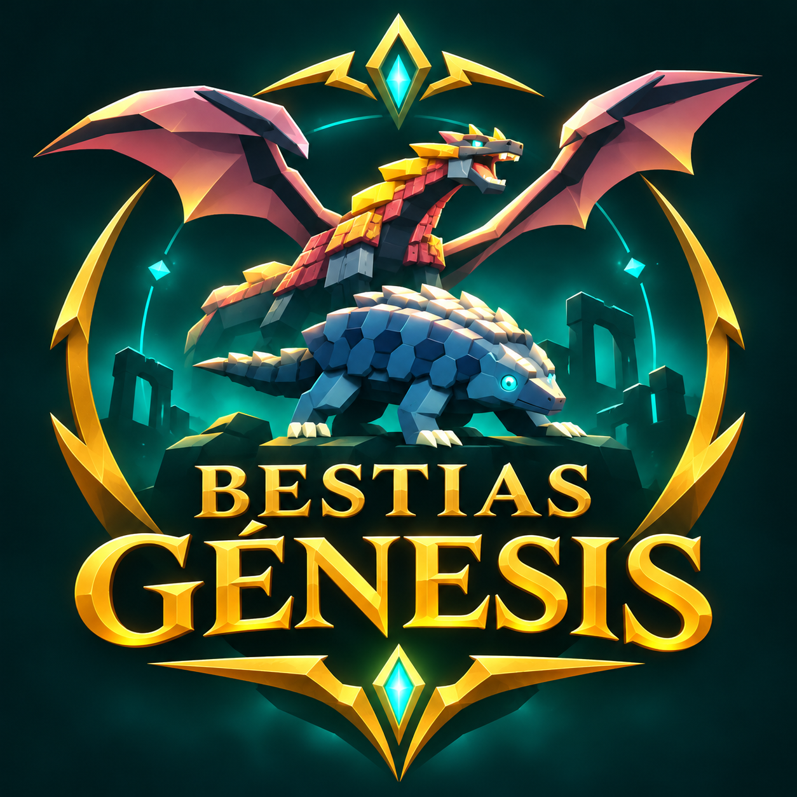
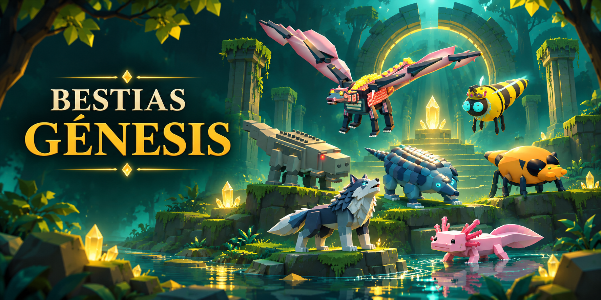
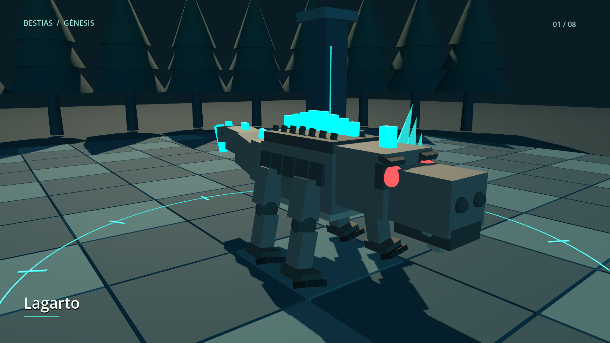
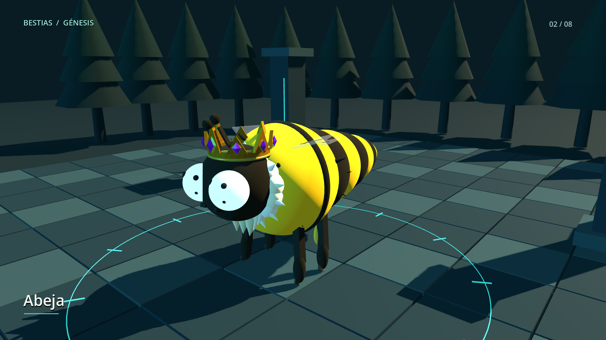
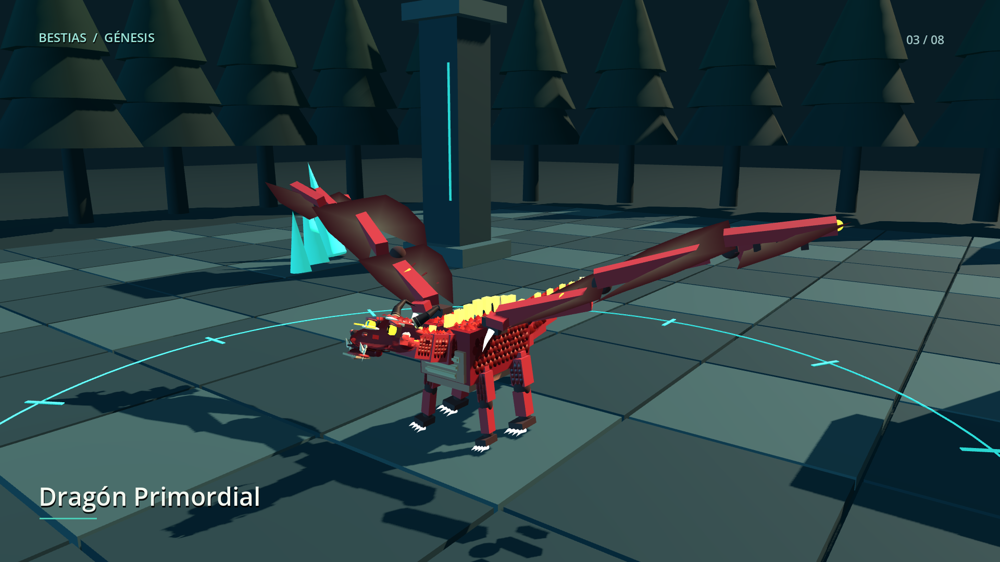
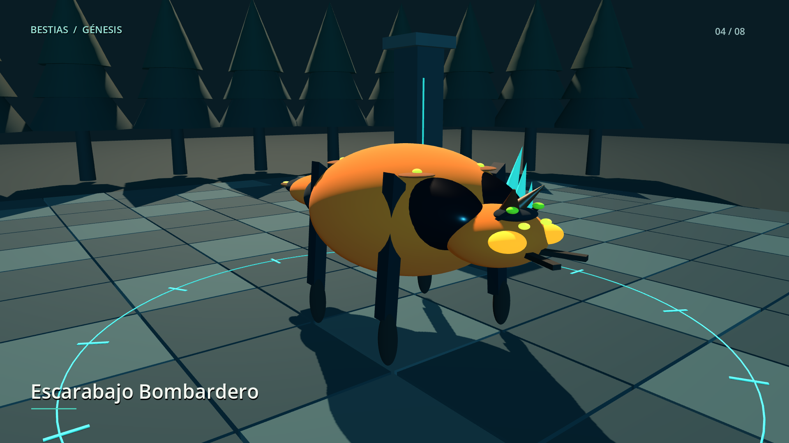
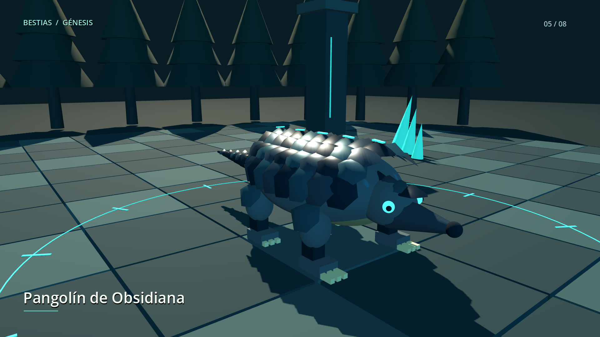
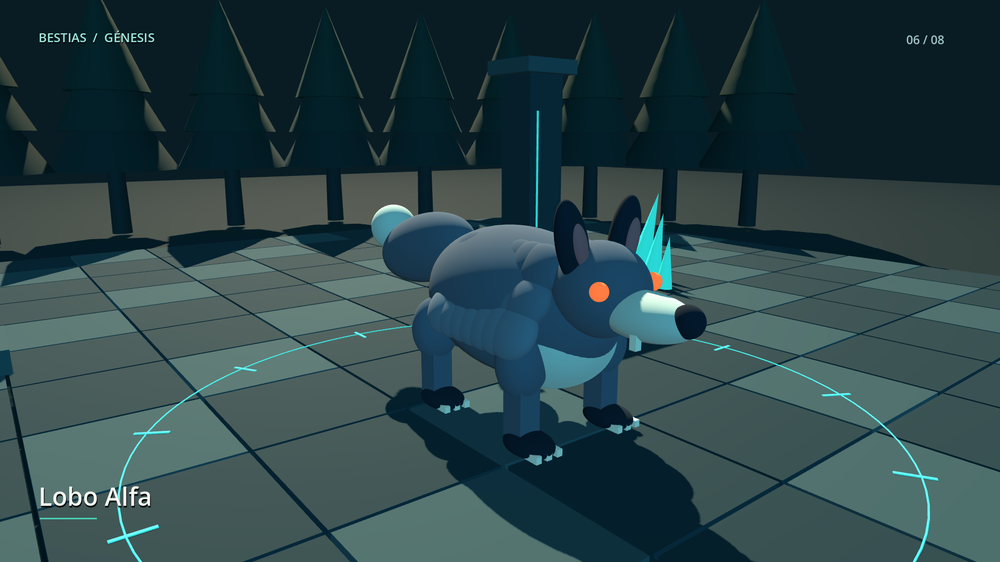
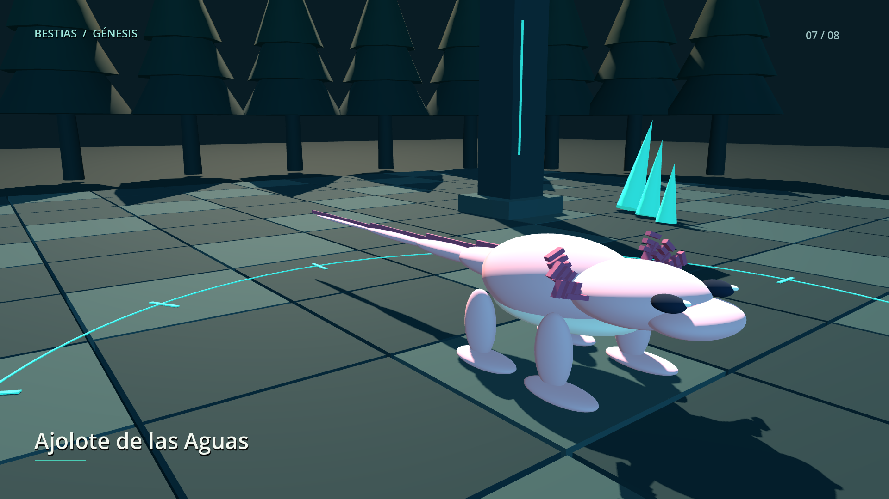
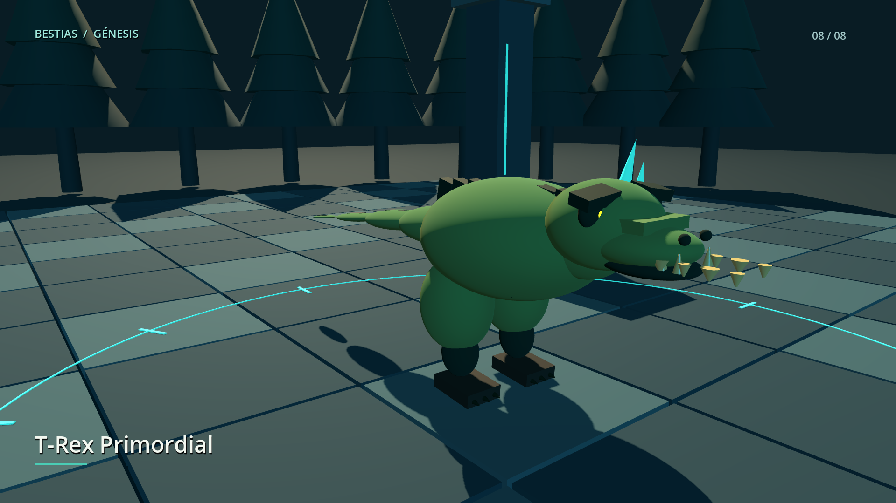

  
   
  

# Bestias Génesis

**Elige entre diez bestias, domina sus habilidades y explora sus dominios en esta aventura 3D gratuita.**

Aventura de acción, exploración y supervivencia en tercera persona, creada por **Dragón Primordial**. La versión **13.2.0** está en desarrollo y se puede jugar en **Windows x64** y **Android ARM64**.

## Descargar y jugar

- [Descargar para Windows x64](https://github.com/dragonprimordial12-netizen/Bestias-Genesis/releases/download/v13.2.0/BestiasGenesis-Windows-x64-v13.2.0.zip)
- [Descargar para Android ARM64](https://github.com/dragonprimordial12-netizen/Bestias-Genesis/releases/download/v13.2.0/BestiasGenesis-Android-ARM64-v13.2.0.zip)
- [Ver todas las versiones](https://github.com/dragonprimordial12-netizen/Bestias-Genesis/releases)

### Windows

1. Extrae el ZIP completo en una carpeta.
2. Abre `BestiasGenesis.exe`.
3. Conserva `BestiasGenesis.pck` y las DLL junto al ejecutable.

### Android

1. Descomprime el ZIP en el dispositivo.
2. Instala `BestiasGenesis-v13.2.0-Android.apk`.
3. El paquete requiere Android ARM64 (64 bits).

No necesitas instalar Godot para jugar. La partida y la progresión local se guardan en el dispositivo. El multijugador LAN permite jugar con otra persona en la misma red.

## Novedades de la versión 13.2.0

- Mapa ampliado con más espacio de exploración y dominios de las bestias.
- Zona del Guardián del Robledal con grupos localizados de slimes, alejados de las áreas de reaparición.
- Los slimes hostiles dejan 5 cristales, 5 puntos de experiencia y un frasco verde que restaura 5 puntos de vida.
- Tras derrotar tres slimes hostiles aparece el slime azul. Al vencerlo, una cinemática presenta al Slime Titán emergiendo entre rocas.
- Duelo contra el Slime Titán dentro de una arena cúbica roja que mantiene a ambos combatientes dentro hasta que uno cae.
- Multijugador LAN, clasificación de bajas y duelos en el Coliseo.
- El Dragón Origami puede transformarse en una espada de origami.

## Diez bestias jugables

Lagarto · Abeja · Dragón Primordial · Escarabajo Bombardero · Pangolín de Obsidiana · Lobo Alfa · Ajolote de las Aguas · T-Rex Primordial · Dragón Origami · Titán del Robledal.

Cada bestia tiene habilidades y progresión propias, con avance hasta el nivel 20. Explora, combate contra criaturas y guardianes, y reúne materiales para fabricar armaduras.

## Controles de PC

| Tecla o botón | Acción |
| --- | --- |
| WASD | Moverte |
| Clic derecho y ratón | Orientar la cámara |
| 0–9 | Seleccionar una habilidad |
| F o clic izquierdo | Usar la habilidad seleccionada |
| R | Cambiar de variante |
| Q | Esquivar |
| Z | Mantener la guardia |
| Shift | Correr |
| L | Recargar maná |
| I | Abrir la mochila |
| V | Transformación del Dragón Origami |

## Carrusel de bestias

Recorre las ocho capturas actualizadas del juego. Haz clic en una imagen para verla a tamaño completo.

  
  

  
  

  
  

  
  

## Créditos y licencias

Desarrollado por **Dragón Primordial** con **Godot**. El proyecto incluye asistencia de IA en programación, textos, audio y material gráfico, además de herramientas procedurales para modelos y animaciones. No se requieren servicios de IA para jugar.

Los avisos y licencias de los recursos distribuidos se encuentran en [`legal/`](legal/). Consérvalos al redistribuir el juego.
