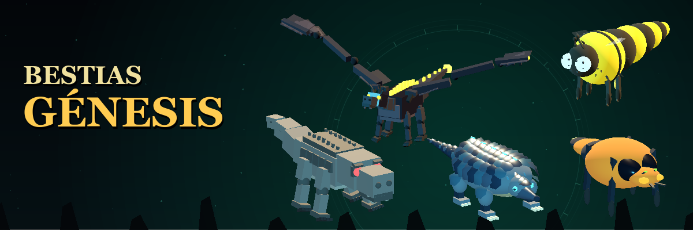
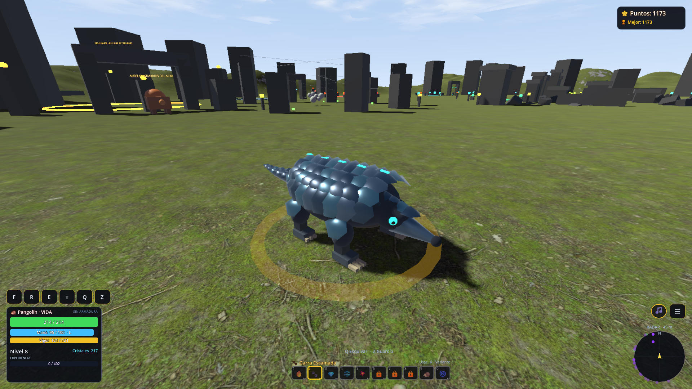
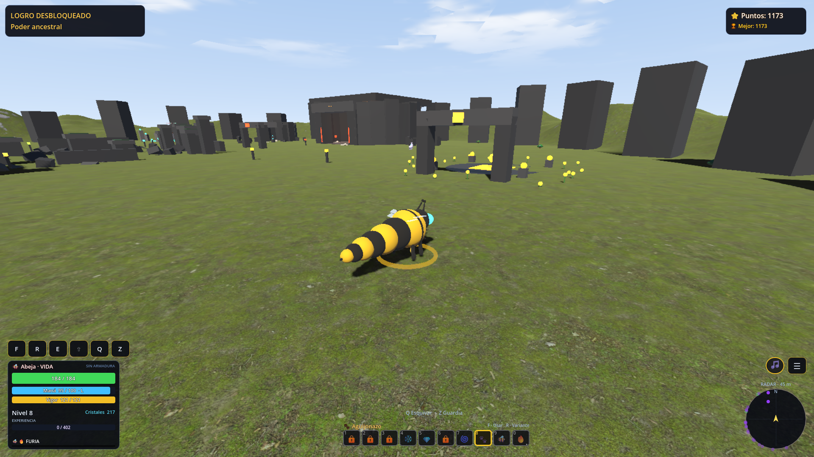
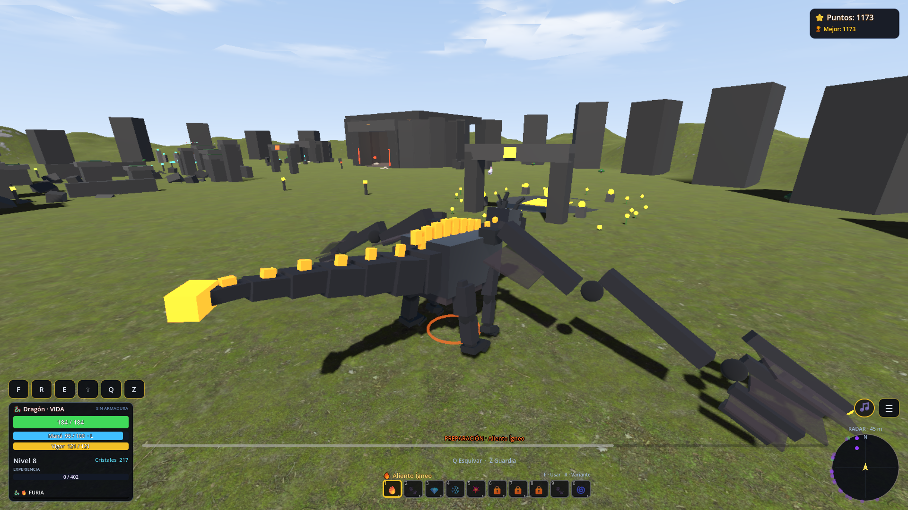
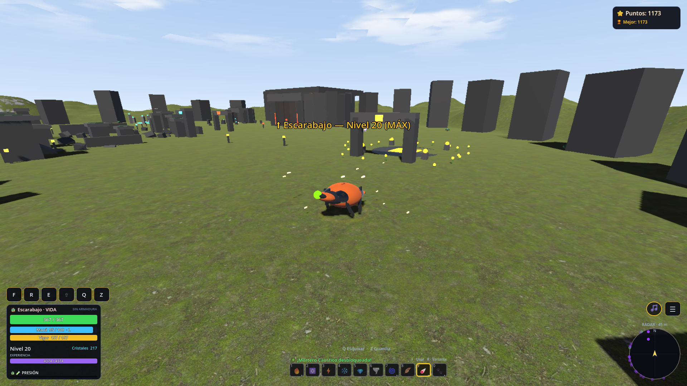
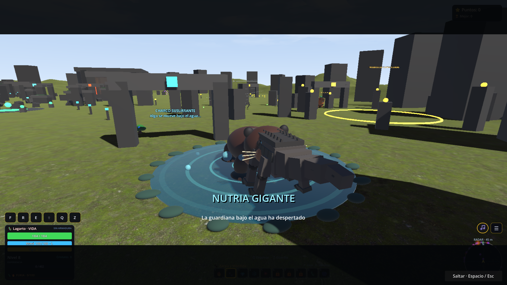

# Bestias Génesis

**Conviértete en una bestia, domina poderes arcanos y desafía a los guardianes de las ruinas.**

Aventura de acción en tercera persona creada por **Dragón Primordial**. Esta es la **versión 7 en desarrollo**, gratuita, para **Windows de 64 bits**, con textos en **español** y para **un jugador**.

## Descargar y jugar

**[Descargar Bestias Génesis v7 para Windows](https://github.com/dragonprimordial12-netizen/Bestias-Genesis/releases/download/v7.0.0/BestiasGenesis-Windows-x64.zip)**

Consulta las versiones disponibles en [Releases](https://github.com/dragonprimordial12-netizen/Bestias-Genesis/releases). También puedes obtener el juego en [itch.io](https://dragonprimordial.itch.io/bestias-genesis).

1. Extrae el ZIP completo en una carpeta.
2. Abre **BestiasGenesis.exe**.
3. Conserva el archivo PCK, las DLL y la carpeta **legal** junto al ejecutable.

No necesitas instalar Godot ni tener Steam abierto. La partida, el equipo y los logros locales se guardan en tu ordenador. El equilibrio, el rendimiento y la presentación pueden cambiar durante el desarrollo.

La descarga ocupa **77.507.494 bytes**. Su huella SHA-256 está en [SHA256SUMS.txt](SHA256SUMS.txt).

## Elige tu bestia

- **Lagarto:** garras, mordidas y Danza del Depredador.
- **Abeja:** aguijón, vuelo ágil y técnicas de enjambre.
- **Escarabajo Bombardero:** Mortero Cáustico y Excavación Sísmica. Vuelve a pulsar F o clic para emerger.
- **Pangolín de Obsidiana:** Garra Escamada y Rueda de Obsidiana para arrollar enemigos.
- **Dragón Primordial:** alas y aliento de fuego. Se desbloquea al alcanzar el nivel 5 con Lagarto y Abeja.

Cada bestia empieza con un ataque cuerpo a cuerpo y conserva su progresión hasta el nivel 20. La mochila permite consultar y equipar las técnicas que desbloqueas.

## Combate y exploración

Prepara tus ataques, esquiva, mantén la guardia y administra vida, maná y vigor. Explora ruinas con ciclo de día y noche, personajes y secretos. Desafía al Oso, Lobo, Araña, Centinela de Cristal y Nutria Gigante.

Fabrica armaduras de hielo, lava y oscuridad con materiales de los jefes. Las armaduras fabricadas se comparten entre tus bestias y puedes llevar una equipada a la vez. Incluye **20 logros locales** y opciones de sonido, pantalla, calidad y sensibilidad.

## Controles

| Tecla o botón | Acción |
| --- | --- |
| WASD | Moverte |
| Clic derecho y ratón | Orientar la cámara |
| 0–9 | Seleccionar habilidad |
| F o clic izquierdo | Usar la habilidad seleccionada |
| R | Cambiar de variante |
| Q | Esquivar |
| Z | Mantener la guardia |
| Shift | Vigor ancestral |
| L | Recargar maná |
| I | Abrir la mochila |

## Capturas reales

Estas capturas muestran partidas con progresión avanzada utilizadas durante las pruebas.

## Créditos

Creado por **Dragón Primordial** con **Godot**. El desarrollo utiliza asistencia de **Claude y Codex** en programación, modelos y animaciones procedurales, textos y síntesis de audio. El juego no requiere servicios de IA durante la partida.

Los créditos y avisos de los complementos y recursos incluidos se pueden consultar dentro del juego y en la carpeta **legal** de la descarga. Consérvalos al distribuir el paquete.
